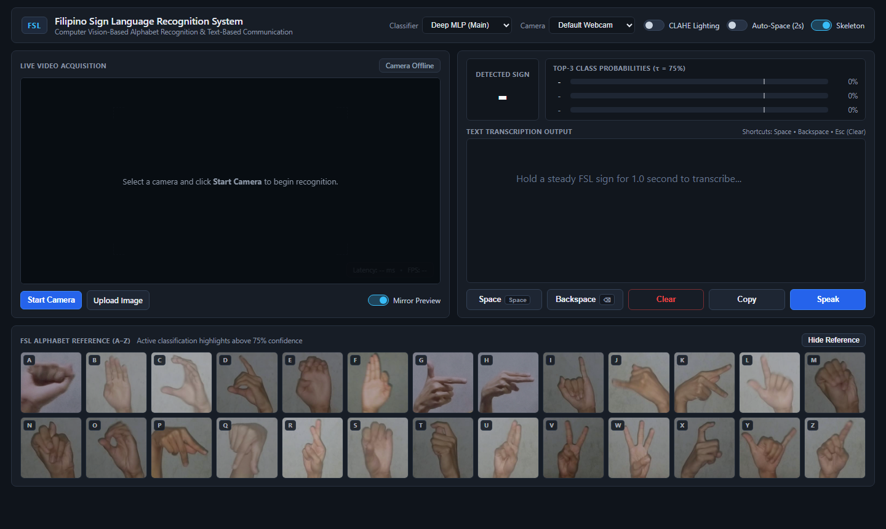

# Filipino Sign Language (FSL) Alphabet Recognition & Word Formation System

A real-time computer vision system that recognizes Filipino Sign Language (`A`–`Z`) fingerspelling gestures from a webcam or uploaded images and assembles confirmed letters into readable text for communication between FSL users and non-signing individuals. Using MediaPipe `HandLandmarker` to extract wrist-relative, scale-normalized 63-dimensional hand coordinates, the system classifies gestures with a landmark-augmented PyTorch Deep MLP (`98.52%` test accuracy, `0.287 ms` CPU latency, `246.0 KB`) compared against an RBF-SVM baseline (`98.23%`), and applies confidence thresholding (`τ = 0.75`), 10-frame majority voting, and `1.0 s` dwell-time confirmation in a live Flask Web UI, PyQt6 desktop app, and unified CLI pipeline.



> **Final Outputs & Charts**: See [`outputs/final/`](./outputs/final) for the live UI captures, confusion matrices, training curves, failure gallery, and reproduced results table.

---

## Requirements

- Python `3.10+` (tested on Python `3.12.5`)
- Webcam (for live recognition; static image upload and CLI batch modes work without a camera)
- Packages listed in [`requirements.txt`](./requirements.txt):
  - `Flask`, `mediapipe`, `opencv-python`, `numpy`, `pandas`, `scikit-learn`, `torch`, `PyQt6`, `matplotlib`, `seaborn`, `joblib`

---

## Installation

```bash
git clone https://github.com/BorceKhen/FSL-Alphabet-Recognition-CSST106-Rhodes_Island.git
cd FSL-Alphabet-Recognition-CSST106-Rhodes_Island
python -m venv .venv
# Windows PowerShell:
.venv\Scripts\Activate.ps1
# macOS / Linux:
# source .venv/bin/activate

pip install -r requirements.txt
```

---

## How to Run the Application

### Option 1: Web UI (Recommended — Live Webcam & Image Upload)
```bash
python -m src.web_app
```
Open **http://127.0.0.1:5000** in your browser, click **Start Camera** (or **Upload Image** to evaluate static test images), and hold a steady sign for `1.0 s` to transcribe text. *(On Windows, you can also double-click `run_app.bat`.)*

### Option 2: Unified Single-Command CLI Pipeline (`src/run.py`)
```bash
python src/run.py --input path/to/images_or_image.jpg --output outputs/run_test/
python src/run.py --input path/to/video.mp4 --output outputs/demo_annotated.mp4
python src/run.py --webcam 0
```

### Option 3: PyQt6 Desktop UI
```bash
python -m src.app
```

### Run Unit Tests
```bash
python -m unittest discover -s tests -v
```

---

## How to Reproduce the Results Table

Run the evaluation script on the held-out 15% test split (`1,753` samples) with one command:

```bash
python -m src.evaluate --split test --weights models/mlp_model.pt
```

This prints the comparison table (after CPU warm-up) and writes metrics and confusion matrices to [`reports/`](./reports).

| Model | Accuracy | Macro Precision | Macro Recall | Macro F1 | CPU Latency (Warm-Up) | Model Size |
| :--- | :---: | :---: | :---: | :---: | :---: | :---: |
| **Baseline RBF-SVM** (`C=50.0, gamma=0.05`) | 98.23% | 98.27% | 98.23% | 98.23% | 1.040 ms | 2,183.8 KB |
| **Deep MLP (Main, Augmented)** (`256-128-64`) | **98.52%** | **98.53%** | **98.52%** | **0.9852** | **0.287 ms** | **246.0 KB** |

---

## Dataset & Model Weights

- **Raw Image Dataset**: [Kaggle FSL Dataset](https://www.kaggle.com/datasets/japorton/fsl-dataset) (`11,700` RGB images, `26` classes `A`–`Z`, `450` images/class, CC0 Public Domain).
  - Configured path in [`src/config.py`](./src/config.py): `FSL Dataset/Collated` (only needed if re-running `python -m src.prepare_dataset`).
- **Pre-Extracted Landmark Splits**: [`data/fsl_landmarks.npz`](./data/fsl_landmarks.npz) (`11,683` detected samples: `8,178` train / `1,752` val / `1,753` test) — documented in [`data/README.md`](./data/README.md).
- **Trained Weights (`models/`)**:
  - [`models/mlp_model.pt`](./models/mlp_model.pt) (`246.0 KB`) & [`models/mlp_scaler.joblib`](./models/mlp_scaler.joblib) — Main Deep MLP classifier
  - [`models/svm_baseline.joblib`](./models/svm_baseline.joblib) (`2,183.8 KB`) — Baseline RBF-SVM pipeline
  - [`models/hand_landmarker.task`](./models/hand_landmarker.task) — MediaPipe 21-keypoint hand landmarker
  - [`models/label_map.json`](./models/label_map.json) — Class index mapping (`0–25` → `A–Z`)

---

## Project Structure

```text
FSL/
├── README.md
├── requirements.txt
├── run_app.bat
├── docs/
│   └── remaining.md          # To-100% milestone checklist
├── src/
│   ├── config.py             # Paths, constants, thresholds (τ=0.75, 10 frames, 1.0s dwell)
│   ├── features.py           # MediaPipe HandLandmarker + 63-dim normalization + CLAHE
│   ├── prepare_dataset.py    # Batch landmark extraction & stratified 70/15/15 split
│   ├── train_baseline.py     # Baseline RBF-SVM training & validation tuning
│   ├── train_mlp.py          # PyTorch Deep MLP training with ±15° landmark augmentation
│   ├── evaluate.py           # Test-set metrics, confusion matrices, CPU latency benchmark
│   ├── postprocess.py        # Confidence filter, 10-frame majority vote, 1.0s dwell buffer
│   ├── run.py                # Unified CLI pipeline (images, folders, video, webcam)
│   ├── app.py                # PyQt6 + OpenCV desktop GUI & shared ModelPredictor
│   ├── web_app.py            # Flask Web UI backend
│   ├── templates/index.html  # Web dashboard HTML
│   └── static/               # Web dashboard CSS & JS
├── tests/
│   └── test_pipeline.py      # Unit tests for normalization, post-processing, and MLP
├── data/                     # Cached 63-dim landmark splits (fsl_landmarks.npz) & Data Card
├── models/                   # Saved weights, scalers, and MediaPipe task model
├── reports/                  # Raw JSON metrics, curves, confusion matrices, test error log
└── outputs/
    └── final/                # Milestone 5 final deliverables (screenshots, charts, tables)
```

---

## Team & Contributions

| Module / Area | Scope | Member / Role |
| :--- | :--- | :--- |
| Data & Preprocessing Pipeline | Dataset structuring, MediaPipe 21-keypoint extraction, 63-dim normalization | Lead ML Engineer |
| Model Development & Training | Baseline RBF-SVM & augmented Deep MLP training and hyperparameter tuning | ML / CV Specialist |
| Post-Processing & Logic | Confidence thresholding (`0.75`), 10-frame smoothing, `1.0 s` dwell-time buffer | Backend Developer |
| Real-Time UI & Integration | Flask Web UI (`src/web_app.py`), CLI (`src/run.py`) & PyQt6 UI (`src/app.py`) | Full-Stack / UI Developer |
| Evaluation & Documentation | Benchmark testing, confusion matrices, final report & defense slides | Systems Lead / Technical Writer |
